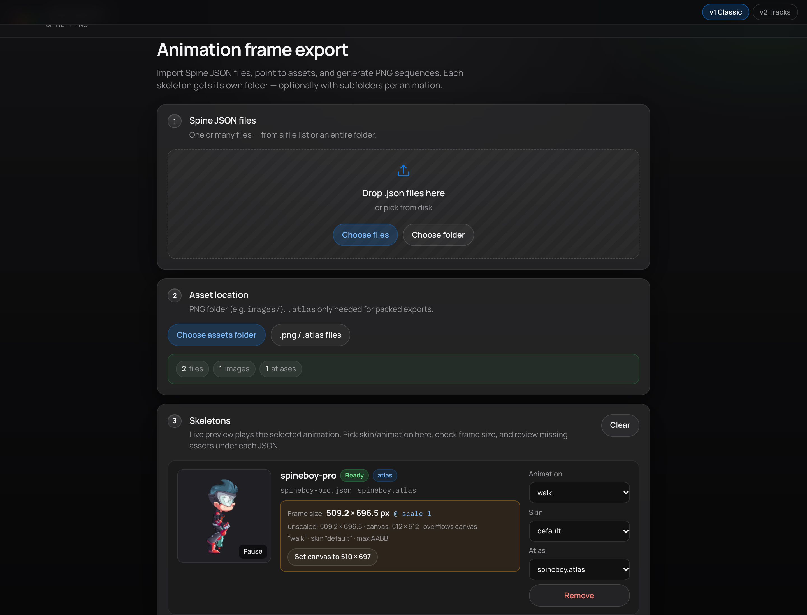
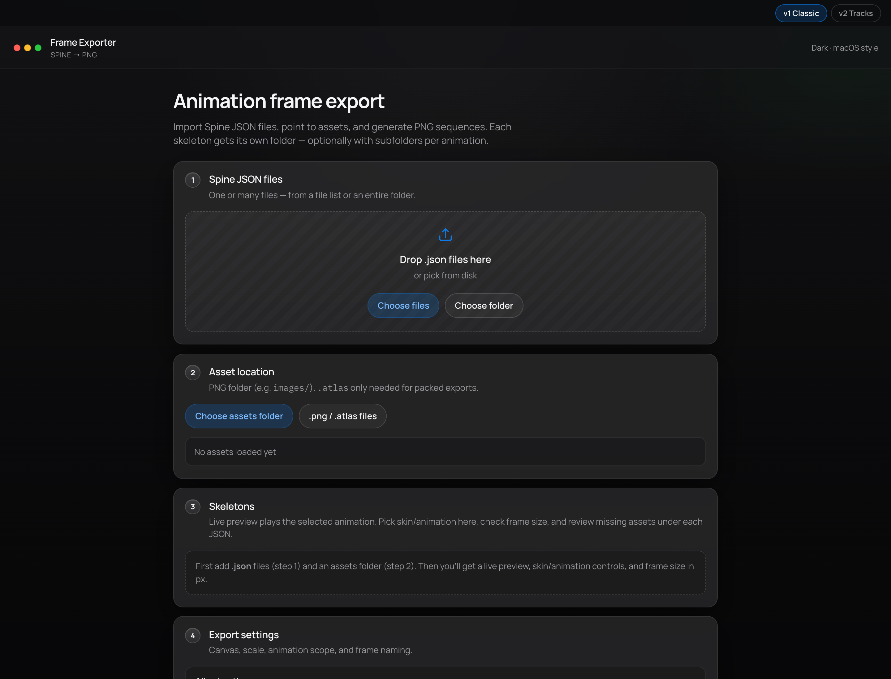
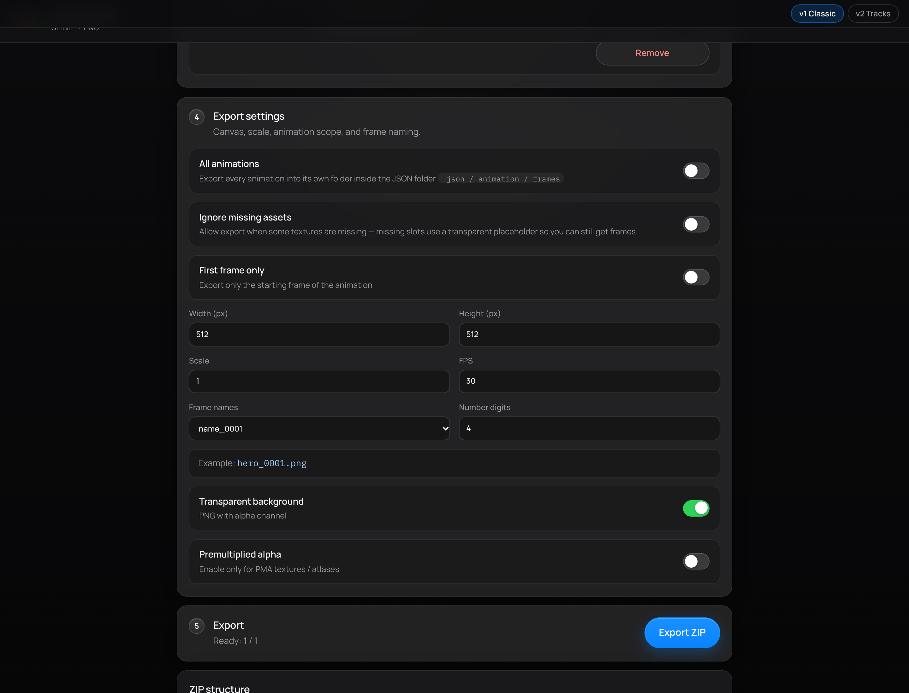
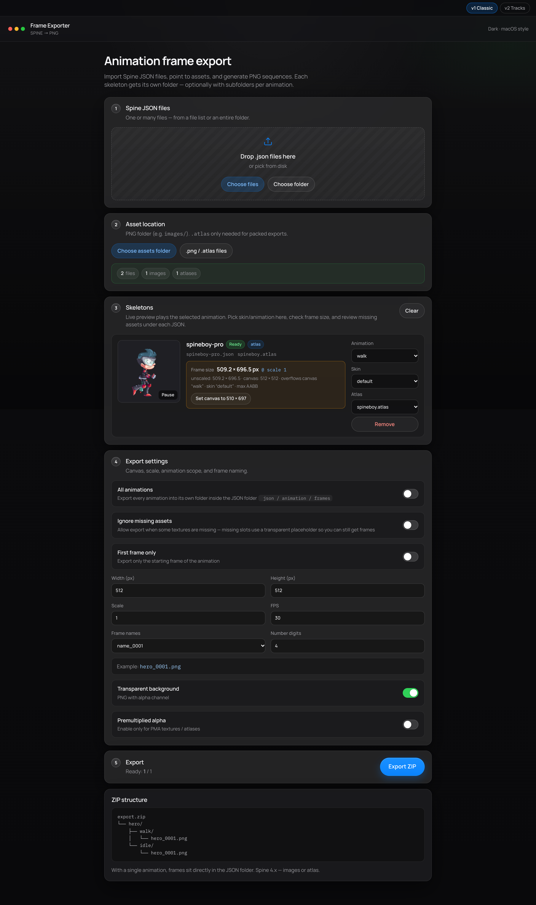
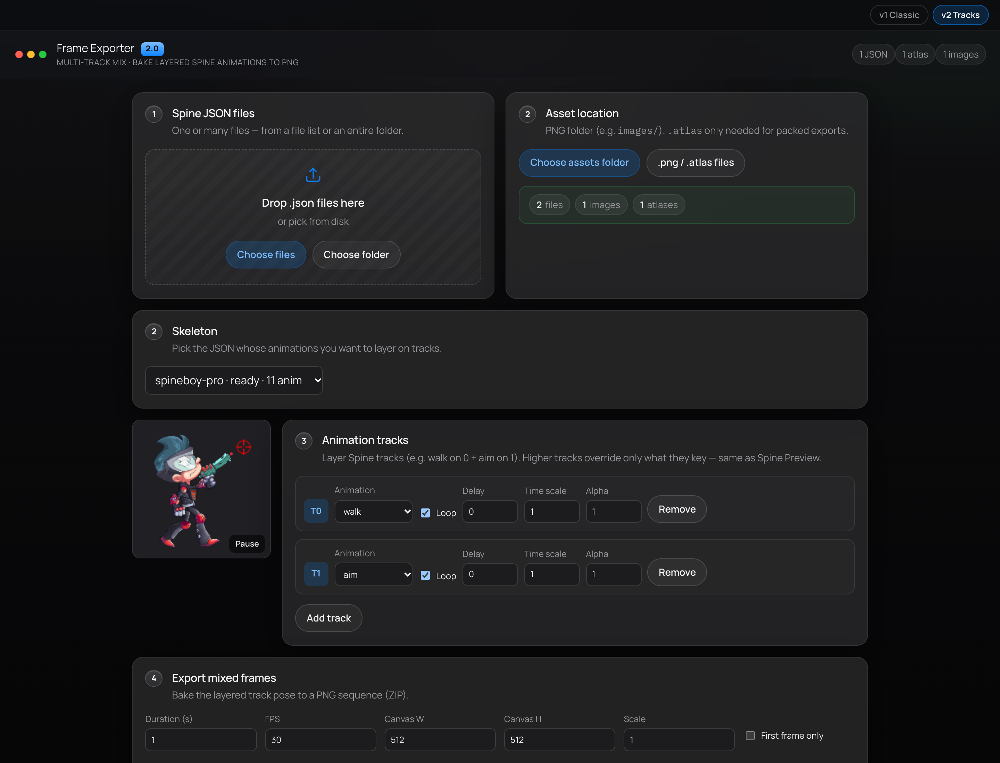
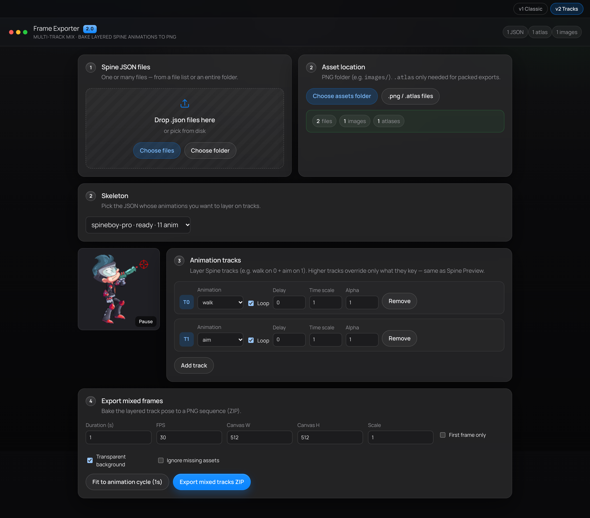

# Frame Exporter

Export PNG frame sequences from Spine **4.x** skeletons — in the browser or as a standalone macOS app.

Two modes:

- **v1 Classic** — one animation (or all animations) → PNG sequence per skeleton
- **v2 Tracks** — layer multiple Spine tracks (e.g. walk + aim) and bake the mix to PNG

<p align="center">
  
</p>

<p align="center"><em>v1 Classic — live WebGL preview, frame-size advice, and per-skeleton animation / skin / atlas controls</em></p>

## Download (macOS)

Prebuilt Apple Silicon build is in [`public/`](./public/):

| File | Description |
|------|-------------|
| [**Frame Exporter_0.1.0_aarch64.dmg**](./public/Frame%20Exporter_0.1.0_aarch64.dmg) | Installer disk image (recommended) |
| [**Frame-Exporter-macOS.zip**](./public/Frame-Exporter-macOS.zip) | Zipped `.app` |
| [`Frame Exporter.app`](./public/Frame%20Exporter.app) | App bundle (clone / sparse checkout) |

Open the app like any Mac app. Export uses a native Save dialog for the ZIP.

> Requires **macOS 11+**, **Apple Silicon (aarch64)**, and a GPU with WebGL.

## Screenshots & features

### v1 Classic — import → preview → export

<p align="center">
  
</p>

**Guided workflow** with numbered steps: drop Spine JSON files, point to an assets folder or `.atlas` + textures, then configure skeletons and export settings. Switch between **v1 Classic** and **v2 Tracks** from the top bar at any time.

---

<p align="center">
  
</p>

**Live animation preview** plays the selected clip in WebGL. Each JSON gets its own card with:

- Status badges (`Ready` / missing assets, atlas vs images mode)
- Animation, skin, and atlas selectors
- Measured **frame size** (scaled AABB) and a one-click **Set canvas to…** when content overflows

---

<p align="center">
  
</p>

**Export settings** cover the full bake pipeline:

- Export **all animations** (subfolder per animation) or a single selected clip
- **Ignore missing assets** (transparent placeholders)
- First frame only, canvas size, scale, FPS
- Frame naming presets or a custom pattern (`{name}`, `{anim}`, `{####}`, …)
- Transparent or solid background, optional premultiplied alpha

---

<p align="center">
  
</p>

**ZIP layout** is predictable: one folder per JSON, optional animation subfolders, PNG names from your pattern. Ready count and progress show in the export bar before you click **Export ZIP**.

### v2 Tracks — multi-track mix

<p align="center">
  
</p>

**Layer Spine tracks** the same way as Spine Preview (e.g. `walk` on track 0 + `aim` on track 1). Higher tracks override only what they key. Per track you can set loop, delay, time scale, and alpha, with a live mixed preview on the left.

---

<p align="center">
  
</p>

**Bake the mix** to a PNG sequence: set duration (or fit to the animation cycle), FPS, canvas, and scale, then export a ZIP of the layered pose.

## Feature list

### v1 Classic

- Import multiple `.json` files at once (files or folder)
- Separate ZIP folder per JSON (optional subfolder per animation)
- Frame naming presets or custom patterns
- Canvas size, scale, FPS, first-frame-only
- Atlas (`.atlas` + textures) **or** images folder
- Skin selection and live WebGL preview
- Frame size preview with suggested canvas
- Ignore missing assets (transparent placeholders)

### v2 Tracks

- Multi-track animation mix (Spine AnimationState tracks)
- Live preview of layered tracks
- Per-track delay, time scale, alpha, loop
- Bake mixed pose to a PNG sequence ZIP

## Requirements

- Spine **4.x** export
- Typical setups:
  - JSON + `images/` folder (no atlas)
  - JSON + `.atlas` + PNG (packed atlas)
- Browser with WebGL (for the web UI)

## Run (web)

```bash
npm install
npm run dev
```

Production build:

```bash
npm run build
npm run preview
```

Switch UI version with the **v1 Classic** / **v2 Tracks** toggle (or `#v1` / `#v2` in the URL).

## Build macOS app (Tauri)

```bash
npm install
npm run tauri:build
```

Bundle output:

- `src-tauri/target/release/bundle/macos/Frame Exporter.app`
- `src-tauri/target/release/bundle/dmg/Frame Exporter_*.dmg`

Copy into `public/` (and optionally `release/`) when publishing a new download.

Dev mode with the desktop shell:

```bash
npm run tauri:dev
```

Requirements: Rust toolchain (`rustup`), Xcode Command Line Tools.

Regenerate app icons from the SVG source:

```bash
npm run icons:generate
```

Refresh README screenshots (dev server must be running):

```bash
SMOKE_URL=http://localhost:5199 node scripts/capture-readme-screenshots.mjs
```

## Usage

1. Import one or more Spine `.json` files
2. Point to the PNG images folder (or `.atlas` + textures)
3. Pick animation / skin (v1) or layer tracks (v2)
4. Set canvas, scale, FPS / duration, and naming
5. Click **Export ZIP**

Name placeholders: `{name}`, `{anim}`, `{frame}`, `{####}`, `{index}`.

## Tests

With the Vite dev server running (e.g. port `5199`):

```bash
npm run test:e2e        # v1 preview + export
npm run test:v2         # v2 multi-track export
npm run test:features   # full feature suite
```
